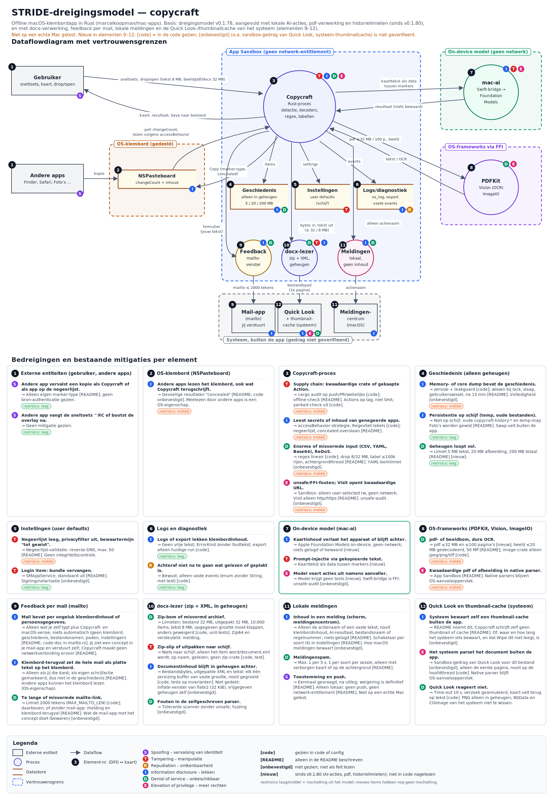

# Dreigingsmodel (STRIDE) — Copycraft

Taal: Nederlands, zowel in dit document als in het plaatje (het bestaande diagram was al Nederlands).

Vectorversie: [stride-threat-model.svg](stride-threat-model.svg).

Het diagram is gebaseerd op het dreigingsmodel van v0.1.78 en aangevuld met wat sinds v0.1.80 nieuw is (lokale AI-acties, pdf-verwerking, geschiedenis alleen in geheugen) en met vier nieuwe elementen (9–12): feedback per mail, de docx-lezer, lokale meldingen en de Quick Look-/thumbnailcache van het systeem.

## Hoe de markeringen te lezen

- **[code]**: in de code gezien (constanten, tests, moduledocumentatie).
- **[README]**: alleen in de README beschreven; niet in de code nagelezen.
- **[onbevestigd]**: niet geverifieerd; niet als feit lezen.
- **[nieuw]**: AI-acties, pdf en historielimieten; uit het ontwerp ingeschat en **niet** in de code gecontroleerd.
- Restrisico laag/middel is een inschatting bij de bestaande items; de nieuwe items (elementen 9–12) hebben nog geen inschatting.
- **Niets is op een echte Mac getest.** Alles over macOS-gedrag (Quick Look, meldingen, mail-app) komt uit de documentatie en de code, niet uit een proef.

## Nieuw: elementen 9–12

### 10. docx-lezer (zipbom, uitpakken, geheugen)

Copycraft leest een `.docx` met een eigen zip-lezer en een eigen XML-scanner (`apps/copycraft/src/docx.rs`), zonder zip-crate en zonder `unsafe`.

| Dreiging | Maatregel | Status |
| --- | --- | --- |
| **D**: zipbom of misvormd archief | Bestand ≤ 32 MB, uitgepakt `word/document.xml` ≤ 32 MB, ≤ 10.000 items, tekst ≤ 8 MB. De opgegeven (gedeclareerde) grootte moet kloppen: een stroom die groter of kleiner is dan opgegeven wordt geweigerd. Zip64 en versleutelde bestanden geven een melding. | [code], unit-tests |
| **T**: zip-slip, uitpakken naar schijf | Niets wordt naar schijf geschreven. Alleen het item met de naam `word/document.xml` wordt gelezen; andere namen worden niet gebruikt als pad. | [code], test |
| **I**: documentinhoud blijft in geheugen achter | Bestandsbytes, uitgepakte XML en uitgelezen tekst zijn elk één zeroizing buffer van vaste grootte die niet groeit (geen realloc met een niet-gewiste kopie). Getest wordt op de invarianten (exacte grootte, capaciteit niet overschreden), niet op vrijgegeven geheugen. **Niet gedekt:** het interne inflate-venster van `flate2` (32 KiB), en wat allocator en OS met pagina's doen. | [code]; rest [onbevestigd] |
| **D/E**: fouten in de zelfgeschreven parser | Tolerante scanner zonder `unsafe`. Fuzzing is niet gedaan. | [code]; fuzzing [onbevestigd] |

### 9. Feedback per mail (mailto)

| Dreiging | Maatregel | Status |
| --- | --- | --- |
| **I**: de mail bevat klembordinhoud of persoonsgegevens | De mail bevat alleen wat de gebruiker zelf typt plus de Copycraft- en macOS-versie. Er wordt niets automatisch toegevoegd (geen klembord, geschiedenis, bestandsnamen, paden of instellingen). De mail-app toont een concept; de **gebruiker verstuurt zelf**. Copycraft maakt er geen netwerkverbinding voor. | [README], moduledocumentatie in `mailto.rs`; niet op een Mac geprobeerd |
| **D**: te lange link | Limiet van 2000 tekens (`MAX_MAILTO_LEN`). Bij een langere tekst, of als geen mail-app `mailto:` afhandelt, volgt een melding en een klembord-terugval. | [code] (limiet), [README] (terugval) |
| **I**: klembord-terugval | De hele mail komt als platte tekst op het klembord, alleen als de gebruiker dat kiest, gemarkeerd als eigen schrijfactie (dus niet in de geschiedenis). Andere apps kunnen het klembord lezen (eigenschap van het OS). | [README] |
| **I**: wat de mail-app met het concept doet (bewaren) | Valt buiten Copycraft. | [onbevestigd] |

### 11. Lokale meldingen

| Dreiging | Maatregel | Status |
| --- | --- | --- |
| **I**: inhoud in een melding | Alleen de naam van de actie of een vaste tekst; nooit klembordinhoud, AI-resultaat, bestandsnaam of regelnummer. Niets over meldingen wordt gelogd. | [README] |
| **I/S**: toestemming | Eén schakelaar per soort melding in Instellingen. Toestemming wordt één keer gevraagd, na uitleg; een weigering is definitief. Alleen lokale meldingen: geen push, geen netwerk-entitlement. | [README] |
| **D**: meldingenspam | Hooguit één melding per 5 s en één per soort per sessie, en alleen bij verborgen kaart of een app op de achtergrond. | [README] |
| **I**: hoe macOS meldingen bewaart of toont (meldingencentrum, vergrendeld scherm) | Valt buiten Copycraft. | [onbevestigd] |

### 12. Quick Look en thumbnailcache van het systeem (buiten de app)

Voor de eerste pagina van een `.docx` vraagt Copycraft de thumbnail-dienst van het systeem om een plaatje (`mac_ui::quicklook`). Het systeem rendert dat buiten de app.

| Dreiging | Maatregel | Status |
| --- | --- | --- |
| **I**: het systeem bewaart een eigen cache | De README zegt dat de Quick Look-thumbnaildienst een eigen cache buiten de app kan houden. Copycraft schrijft zelf geen thumbnail- of cachebestand; het PNG blijft in geheugen. Of, waar en hoe lang het systeem iets bewaart, en dat Wipe dit niet leegt, is niet geverifieerd. | [README]; systeemgedrag [onbevestigd] |
| **E**: het systeem leest en parset het document buiten de app | Alleen de eerste pagina, nooit op de hoofdthread. Het sandbox-gedrag van Quick Look voor dit bestand is niet geverifieerd; een native parser blijft aanvalsoppervlak van het OS. | [code]; sandbox [onbevestigd] |
| **D**: Quick Look reageert niet | Time-out van 10 s, het verzoek wordt geannuleerd en de kaart valt terug op de tekst. | [code] |
| **I**: geheugen van het plaatje | Het PNG wordt één keer, op exacte grootte, in een zeroizing buffer gekopieerd. De `NSData`, bitmap en `CGImage` van het systeem worden niet gewist en kunnen we niet wissen. | [code]; rest [onbevestigd] |

## Algemeen

- De geschiedenis staat alleen in geheugen; er wordt niets naar schijf geschreven.
- Zie ook [SECURITY.md](../SECURITY.md).
